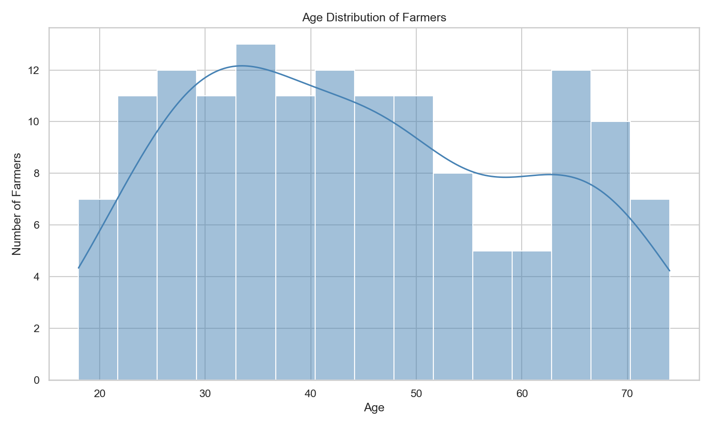
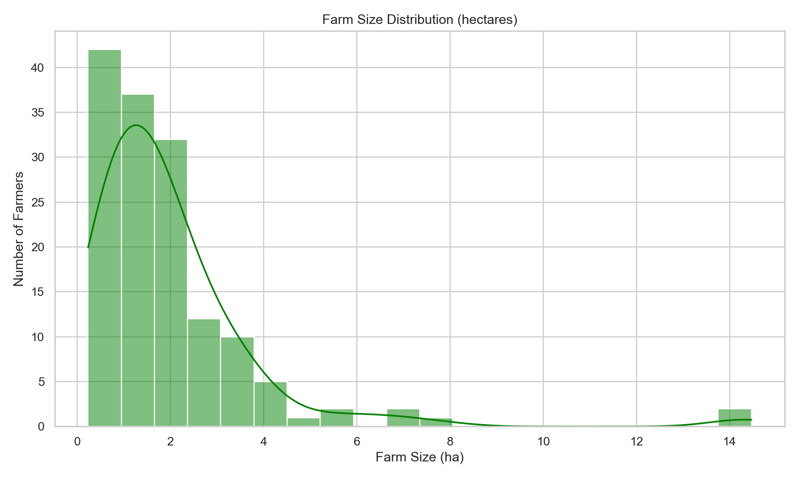
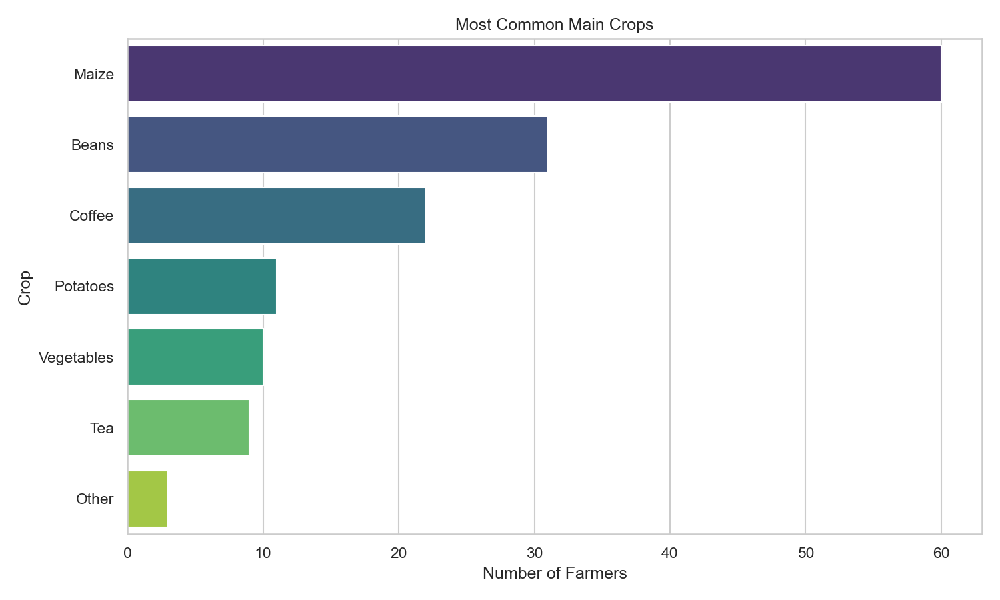
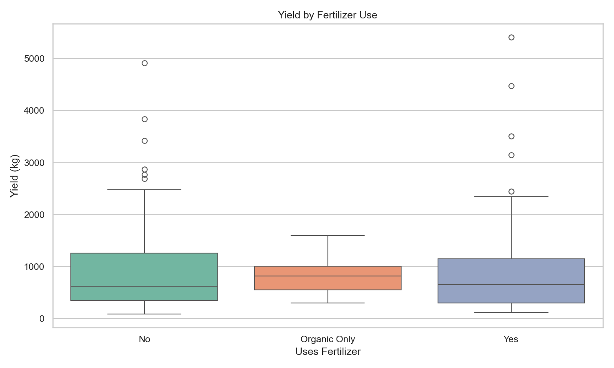
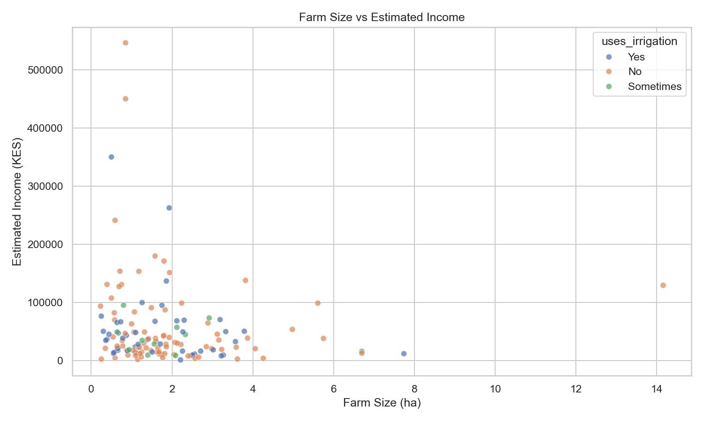
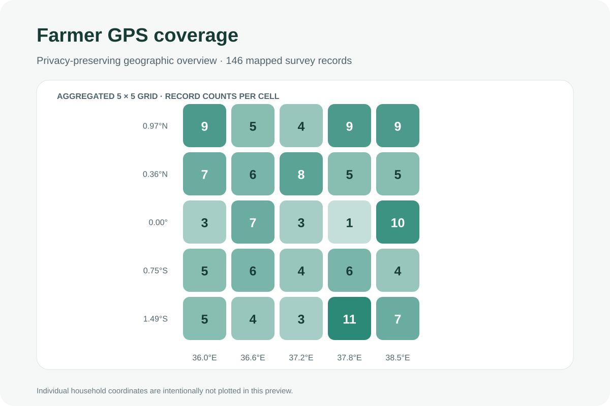
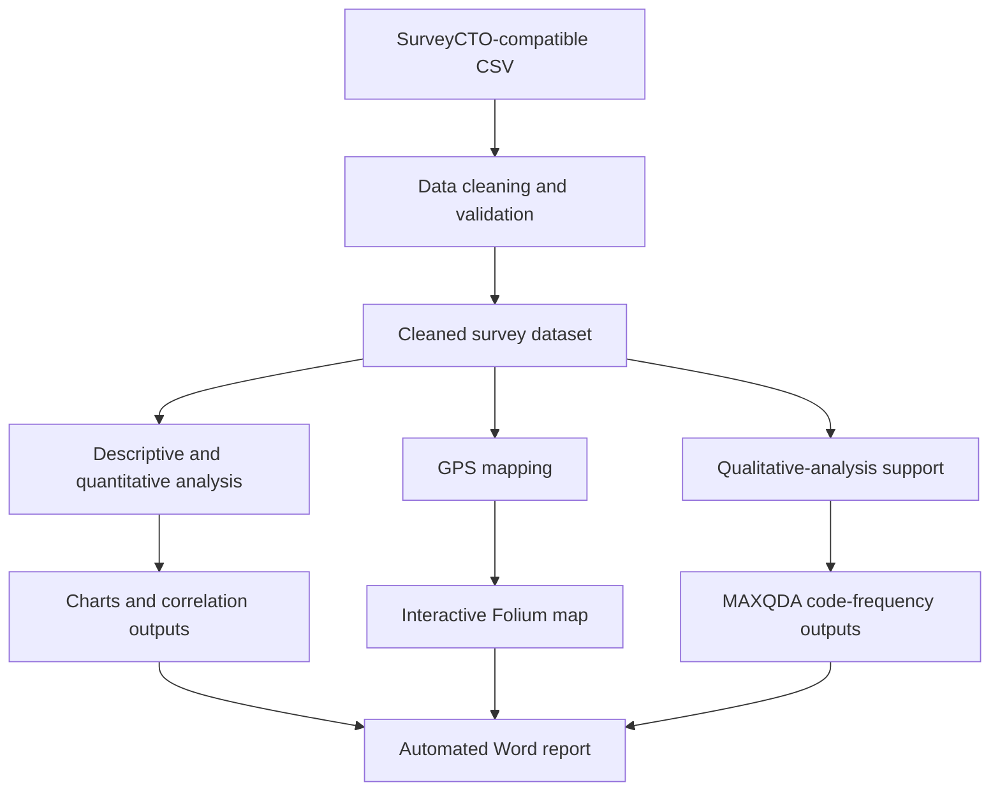

<div align="center">

# AgriSurvey Analytics Pipeline

### From digital agricultural surveys to actionable evidence

**A reproducible, end-to-end analytics workflow for agricultural research, programme monitoring and evidence-informed decision-making.**

[](https://www.python.org/)
[](https://pandas.pydata.org/)
[](https://matplotlib.org/)
[](https://python-visualization.github.io/folium/)
[](https://www.maxqda.com/)

**Built by [Larry Onyango](https://github.com/Mclarroh) · Nairobi, Kenya**

</div>

---

## Project at a glance

AgriSurvey Analytics Pipeline demonstrates how a digital agricultural survey can be transformed into a structured analytical workflow: data cleaning, validation, descriptive statistics, visual exploration, geospatial analysis, qualitative-analysis support and automated report generation.

The repository is designed as a practical portfolio demonstration of the analytical processes that support agricultural research, MEL/MEAL, NGO programme monitoring and research consultancy assignments.

| Workflow component | What it demonstrates |
|---|---|
| Digital survey data | Import of SurveyCTO-compatible CSV exports |
| Data preparation | Standardisation, validation and implausible-value checks |
| Quantitative analysis | Descriptive statistics, categorical summaries and correlations |
| Visual analytics | Five charts generated with Matplotlib and Seaborn |
| Geospatial analysis | Interactive Folium map with clustered farmer markers |
| Qualitative research support | MAXQDA project and code-frequency outputs |
| Reporting | Automated Word report generation |
| Optional distribution | Email-delivery script, subject to secure configuration |

## Visual portfolio

The figures below are existing analytical outputs generated by the project scripts. They are included here so visitors can inspect the analytical work without first downloading the repository.

### 1. Farmer profile and farm characteristics

<table>
<tr>
<td width="50%">

**Age distribution**



</td>
<td width="50%">

**Farm-size distribution**



</td>
</tr>
<tr>
<td width="50%">

**Main crops reported**



</td>
<td width="50%">

**Yield by fertiliser use**



</td>
</tr>
</table>

### 2. Farm size and estimated income



### 3. Geospatial coverage

The static preview below groups the 146 mapped survey records into a 5 × 5 geographic grid. It is intentionally aggregated: individual household coordinates are not plotted in this portfolio preview.



The project also generates an interactive Folium map at `outputs/farmers_map.html`, using marker clustering and map tiles. **Review and anonymise the underlying records before sharing an interactive respondent-level map.** See the data-governance note below.

## Analytical workflow



### Stage 1 — Data cleaning and quality assurance

Script: [`01_clean_data.py`](scripts/01_clean_data.py)

- Imports the raw survey CSV.
- Standardises selected categorical fields.
- Checks implausible age, farm-size, yield and income values.
- Checks GPS coordinates against broad Kenya coordinate bounds.
- Creates a GPS-validity flag and a simple completeness score.
- Exports the cleaned dataset.

### Stage 2 — Quantitative analysis and charts

Script: [`02_quant_analysis.py`](scripts/02_quant_analysis.py)

- Produces descriptive statistics for key numeric variables.
- Summarises gender, crop, fertiliser and irrigation categories.
- Generates five charts for farmer characteristics and agricultural indicators.
- Calculates and exports a numeric correlation matrix.

### Stage 3 — Geospatial analysis

Script: [`03_create_map.py`](scripts/03_create_map.py)

- Selects records with valid latitude and longitude.
- Creates an interactive Folium map.
- Uses marker clustering to support exploration at different zoom levels.
- Adds respondent-level popup fields in the generated map.

The respondent-level popup design is suitable only for appropriately authorised, protected data. For public demonstrations, use synthetic or anonymised records and avoid publishing precise household locations.

### Stage 4 — Qualitative-analysis support

The repository includes a MAXQDA project file and an Excel code-frequency output. These artefacts demonstrate how qualitative coding outputs can sit alongside quantitative survey analysis in a mixed-methods workflow.

### Stage 5 — Automated reporting

Script: [`04_make_report.py`](scripts/04_make_report.py)

Generates `outputs/Agriculture_Survey_Report.docx`, combining descriptive indicators, charts and written interpretation into a Word report.

An optional email script is available at [`05_send_email.py`](scripts/05_send_email.py). Configure any credentials outside the repository; never commit passwords, tokens or private SMTP settings.

## Repository structure

```text
AgriSurvey-Analytics-Pipeline/
├── data/
│   └── agriculture_survey_raw_surveycto.csv
├── cleaned/
│   ├── agriculture_clean.csv
│   └── agriculture_clean.xlsx
├── docs/
│   ├── Farmer_Survey_Questionnaire.docx
│   └── images/
│       └── farmer-gps-coverage.svg
├── outputs/
│   ├── 01_age_distribution.png
│   ├── 02_farm_size_distribution.png
│   ├── 03_main_crops.png
│   ├── 04_yield_by_fertilizer.png
│   ├── 05_size_vs_income.png
│   ├── farmers_map.html
│   ├── correlations.csv
│   ├── maxqda_code_frequencies.xlsx
│   └── Agriculture_Survey_Report.docx
├── scripts/
│   ├── 01_clean_data.py
│   ├── 02_quant_analysis.py
│   ├── 03_create_map.py
│   ├── 04_make_report.py
│   └── 05_send_email.py
└── README.md
```

## Run the pipeline

### Requirements

- Python 3
- pandas
- NumPy
- Matplotlib
- Seaborn
- Folium
- python-docx
- openpyxl (for Excel outputs)

Install the dependencies:

```bash
pip install pandas numpy matplotlib seaborn folium python-docx openpyxl
```

Run the scripts from the repository root, in this order:

```bash
python scripts/01_clean_data.py
python scripts/02_quant_analysis.py
python scripts/03_create_map.py
python scripts/04_make_report.py
```

The optional email script is separate and should only be run after secure email configuration.

## Data governance and responsible interpretation

Agricultural survey records can contain sensitive information. Before using this workflow with real respondents or publishing project files:

- Remove names, phone numbers, SIM/device identifiers, usernames and other direct identifiers.
- Do not publish exact household GPS coordinates or respondent-level map popups.
- Confirm informed consent, lawful authority and permission for public release.
- Use synthetic or properly anonymised records in a public portfolio.
- Document missing data, exclusions, transformations and limitations.
- Avoid interpreting descriptive associations as causal programme impacts.

**Repository review note:** The current repository contains row-level survey and geospatial artefacts. Confirm that the published records are synthetic or have been appropriately authorised and anonymised before presenting them as public research data. The map preview embedded above is aggregated; it does not replace a privacy review of the underlying CSV files and interactive HTML map.

## About the author

**Larry Onyango** is a Nairobi-based Monitoring, Evaluation, Research and Data Analytics professional with a BSc in Agricultural Economics from Egerton University. His analytical interests include MEL/MEAL systems, agricultural research, survey data quality, quantitative and qualitative analysis, geospatial visualisation and evidence-informed programme decisions.

- **GitHub:** [github.com/Mclarroh](https://github.com/Mclarroh)
- **LinkedIn:** [linkedin.com/in/larry-onyango-96a205129](https://linkedin.com/in/larry-onyango-96a205129/)

---

<div align="center">

**A practical demonstration of the journey from survey data to decision-ready reporting.**

</div>
